<p align="center">
  
</p>

# 🌐 Awesome Multi-Currency Payment Processing [](https://awesome.re)

> 🚀 **A curated directory of enterprise SaaS platforms, payment service providers (PSPs), currency conversion APIs, and self-hosted open-source payment orchestration infrastructure for global multi-currency commerce.**

[](https://github.com/ishandutta2007/Awesome-Awesome-Awesome)
[](https://discord.gg/jc4xtF58Ve)
[](https://github.com/ishandutta2007/Awesome-Multi-Currency-Payment-Processing/stargazers)
[](https://opensource.org/licenses/MIT)
[](https://github.com/ishandutta2007/Awesome-Multi-Currency-Payment-Processing/blob/main/README.md#how-to-contribute)
[](#)
[](https://github.com/ishandutta2007)

---

## 📑 Table of Contents

- [📊 Sector Overview & Market Dynamics](#-sector-overview--market-dynamics)
- [💳 SaaS & Commercial Hosted Platforms](#-saas--commercial-hosted-platforms)
- [🔓 Open-Source GitHub Projects](#-open-source-github-projects)
  - [⚡ Payment Orchestration & Core Engines](#-payment-orchestration--core-engines)
  - [💱 Exchange Rate Engines & Currency Utilities](#-exchange-rate-engines--currency-utilities)
  - [🧪 Reference Implementations & Banking Demos](#-reference-implementations--banking-demos)
  - [🪙 Multi-Currency Crypto & Alternative Rails](#-multi-currency-crypto--alternative-rails)
- [🛠️ Architectural Considerations: Build vs. Buy](#️-architectural-considerations-build-vs-buy)
- [🤝 How to Contribute](#-how-to-contribute)
- [💖 Support & Sponsorship](#-support--sponsorship)
- [📈 Star History](#-star-history)
- [⚖️ Disclaimer & Compliance Notes](#️-disclaimer--compliance-notes)

---

## 📊 Sector Overview & Market Dynamics

The global cross-border payments sector is valued at approximately **$190 trillion to $250 trillion** in total annual transaction volume, generating over **$290 billion** in payment processing revenues and projected to surpass **$330 trillion** by 2030 (driven by international e-commerce, global workforce remittances, B2B supplier settlement, and borderless SaaS platforms).

Market dynamics show **moderate fragmentation in frontend merchant acquiring paired with high concentration at the underlying clearing, settlement, and banking rail tiers**; while thousands of regional PSPs, ISOs, and fintech platforms compete for merchant checkout volume, foundational settlement liquidity and multi-currency correspondent banking are dominated by a concentrated group of financial institutions and mega-scale fintechs (such as Adyen, Stripe, PayPal, and J.P. Morgan), alongside specialized cross-border FX networks like Wise and Airwallex.

---

## 💳 SaaS & Commercial Hosted Platforms

A comprehensive benchmark of leading global payment service providers, multi-currency virtual accounts, and cross-border settlement solutions.

> *The table is sorted descending by company scale (valuation / market capitalization).*

| 🏢 Platform / Service | 📈 Scale (Valuation / Revenue) | 🏷️ Specific Starting Pricing Tier | 🎁 Free Tier Limits / Trial Period | 🌍 Currencies Supported & Core Strengths |
| :--- | :--- | :--- | :--- | :--- |
| **[Shopify Payments Multi-currency](https://www.shopify.com/payments)** | **~$140B Market Cap** ($8.8B Rev) | **$39/mo** (Basic Shopify) + 2.9% + $0.30 per transaction + 1.5% to 2.0% currency conversion fee | **3-day free trial** + $1/month for the first 3 months across standard plans | 130+ currencies supported; automatic conversion, localized payout routing, and native checkout conversion directly inside Shopify. |
| **[PayPal Multi-Currency](https://www.paypal.com/)** | **~$70B Market Cap** ($31.8B Rev) | **3.49% + $0.49** per transaction (US standard); **1.50% cross-border fee** + 3.0% to 4.0% FX spread on conversions | **Free forever standard business account**; zero monthly maintenance fee; pay-per-transaction on processed payments | 25+ holdable currencies; buyer recognition worldwide, automated balance rebalancing, and instant merchant payouts. |
| **[Stripe Elements Multi-Currency](https://stripe.com/payments/elements)** | **~$70B Valuation** ($16B+ Rev) | **2.9% + $0.30** per card transaction + **1.0% international card fee** + **1.0% currency conversion fee** | **Free forever account access**; no monthly SaaS fee; sandbox mode with unlimited test API transactions | 135+ currencies; dynamic localized payment methods, Adaptive Pricing API, multi-currency customer balances, and Stripe Tax. |
| **[Adyen Multi-Currency](https://www.adyen.com/)** | **~$45B Market Cap** (€2.0B Net Rev) | **€0.11 ($0.12) fixed interchange-plus fee** per transaction + interchange rate and variable acquirer fees | **Free forever test account / test sandbox** with full API access; zero monthly recurring account maintenance fee | 150+ currencies; tier-1 enterprise acquiring, intelligent local routing, multi-currency like-for-like settlement, and POS terminals. |
| **[Revolut Business](https://www.revolut.com/business/)** | **~$45B Valuation** ($2.2B Rev) | **$0/mo** (Basic Plan) or **$30/mo** (Grow tier); FX exchange at interbank rates + 0.6% markup once exceeding monthly plan allowances | **Free forever Basic tier** ($0/mo with 5 free local transfers and FX exchange at interbank rates up to $1,000/mo) | 25+ currencies held; multi-currency corporate debit cards, automated batch contractor payouts, and fast international SWIFT/SEPA transfers. |
| **[Wise Business](https://wise.com/business/)** | **~$10B Market Cap** (£1.2B Rev) | **$31 one-time registration fee**; transfers starting from **0.33% to 0.45% FX markup** above mid-market rate; 0% monthly fee | **Free forever account access** after one-off account setup; free multi-currency IBAN balance holding and free incoming local payments | 40+ currencies held with local receiving accounts in 9+ currencies (USD, EUR, GBP, AUD, SGD, etc.); mid-market exchange rate without hidden markups. |
| **[Airwallex](https://www.airwallex.com/)** | **~$6B Valuation** ($500M+ ARR) | **$0/mo Explorer Plan**; card payments from **2.8% + $0.30**; FX margin starting at **0.40% to 0.60%** above wholesale interbank rate | **Free forever Explorer tier** with no monthly fees; zero cost to open global multi-currency accounts and receive domestic payments | 60+ countries and 23+ holding currencies; borderless virtual cards, local domestic clearing access, and cross-border API rails. |
| **[WorldFirst](https://www.worldfirst.com/)** *(Ant Group)* | **~$3B Valuation** ($200M+ Rev) | **$0/mo**; zero transfer fees on major routes; transparent FX margin starting between **0.15% and 0.50%** based on annual payment volume | **Free forever World Account**; zero opening fee; zero monthly management fee; free collections from major global marketplaces | 40+ currencies; local receiving bank details in 14+ regions; specialized supplier settlement for global B2B exporters and e-commerce sellers. |
| **[Payoneer](https://www.payoneer.com/)** | **~$2B Market Cap** ($900M+ Rev) | **$0 to $29.95/yr** (inactivity fee waived if receiving >$2,000/yr); card checkout at **3.0% - 3.99%**; FX conversion fee up to **2.0%** | **Free account activation**; no monthly fee (annual $29.95 fee applies only if account remains inactive without transactions for 12 months) | 150+ countries and 70+ currencies; global contractor payouts, direct marketplace integrations (Upwork, Amazon, Fiverr), and master debit cards. |
| **[Currenxie](https://www.currenxie.com/)** | **~$150M Valuation** ($30M+ Rev) | **$0/mo**; free local bank incoming transfers; outgoing cross-border transfers from **$3 to $8 flat** + FX margin from **0.25% to 0.40%** | **Free forever Global Account**; zero sign-up fee; zero monthly maintenance fees; free multi-currency digital wallet storage | 30+ currencies; proprietary Global Account infrastructure with virtual IBANs across APAC, Europe, and the Americas for business settlements. |

---

## 🔓 Open-Source GitHub Projects

Open-source multi-currency infrastructure spanning payment gateways, orchestration layers, double-entry financial ledgers, and rate engines.

> *The repositories below are ranked descending by GitHub Stars_Count.*

### ⚡ Payment Orchestration & Core Engines

- **[Hyperswitch](https://github.com/juspay/hyperswitch)** [](https://github.com/juspay/hyperswitch/stargazers)  
  A blazing-fast, community-driven payment orchestration engine written in **Rust** (Apache-2.0). Connects with 120+ payment processors and global payment methods with zero vendor lock-in, automated smart routing, distributed retries, multi-currency checkout optimization, and PCI-compliant vault architecture.

- **[Medusa](https://github.com/medusajs/medusa)** [](https://github.com/medusajs/medusa/stargazers)  
  The leading open-source headless commerce and digital payments platform (Node.js / TypeScript, MIT). Offers first-class multi-currency region management, dynamic currency pricing matrices, custom exchange rate calculation hooks, and decoupled checkout payment plugins.

- **[BTCPay Server](https://github.com/btcpayserver/btcpayserver)** [](https://github.com/btcpayserver/btcpayserver/stargazers)  
  Self-hosted, open-source multi-asset cryptocurrency payment processor (.NET, MIT) engineered to operate with zero transaction fees, zero third-party intermediaries, dynamic fiat-to-crypto pricing conversion, and invoice generation in over 50+ fiat currencies.

- **[Kill Bill](https://github.com/killbill/killbill)** [](https://github.com/killbill/killbill/stargazers)  
  Production-tested open-source subscription billing and payments platform (Java, Apache-2.0). Provides multi-currency invoice generation, automated payment routing plugins, dunning management, and enterprise-grade ledger integration.

- **[Liberapay](https://github.com/liberapay/liberapay.com)** [](https://github.com/liberapay/liberapay.com/stargazers)  
  Recurrent donations and multi-currency crowd-funding platform (Python, CC0-1.0). Handles multi-currency wallet balances, dynamic exchange rate conversions, and payout settlement across SEPA, Stripe, and PayPal rails.

- **[GNU Taler](https://www.gnu.org/software/taler/)** [](https://git.taler.net/)  
  Privacy-preserving open-source electronic payment protocol and system (GNU AGPL-3.0). Supports payments in multiple digital currencies and national currencies with mathematically verifiable anonymity for consumers and cryptographic accountability for merchants.

- **[Formance Stack](https://github.com/formancehq/stack)** [](https://github.com/formancehq/stack/stargazers)  
  Programmable financial core and multi-currency double-entry ledger platform (Go, Apache-2.0). Powers complex cross-border money movements, dynamic wallet balances, multi-currency settlement tracking, and payment flows.

- **[Recurso](https://github.com/recurso-dev/recurso)** [](https://github.com/recurso-dev/recurso/stargazers)  
  Modern open-source recurring billing and payment engine (Go + PostgreSQL, MIT). Features multi-currency invoicing, cross-border tax compliance (GST / VAT / US Sales Tax), and multi-gateway payment processing.

---

### 💱 Exchange Rate Engines & Currency Utilities

- **[Dinero.js](https://github.com/dinerojs/dinero.js)** [](https://github.com/dinerojs/dinero.js/stargazers)  
  Immutable library for creating, calculating, formatting, and converting multi-currency monetary amounts in JavaScript and TypeScript (MIT). Prevents IEEE 754 floating-point inaccuracies in financial calculations.

- **[Money PHP](https://github.com/moneyphp/money)** [](https://github.com/moneyphp/money/stargazers)  
  PHP implementation of Fowler's Money Pattern (MIT). Encapsulates currency values, rounding modes, historical exchange rate loaders, and high-precision multi-currency arithmetic.

- **[RubyMoney](https://github.com/RubyMoney/money)** [](https://github.com/RubyMoney/money/stargazers)  
  Standard Ruby library for handling money and currency conversion (MIT). Features comprehensive ISO-4217 currency definitions, dynamic exchange rate banks, and financial formatting.

- **[Exchange API](https://github.com/fawazahmed0/exchange-api)** [](https://github.com/fawazahmed0/exchange-api/stargazers)  
  Free, open-source daily currency exchange rate API tracking 150+ currencies and 500+ cryptocurrencies (MIT). Delivers zero-latency CDN-hosted exchange rate endpoints for client-side currency conversions.

- **[openrate](https://github.com/vul-os/openrate)** [](https://github.com/vul-os/openrate/stargazers)  
  High-performance currency exchange rate engine (Go, MIT). Collects and grades real-time rates with confidence scoring from central banks (ECB, SARB) and institutional feeds with an embedded HTTP API.

---

### 🧪 Reference Implementations & Banking Demos

- **[GEN-PAY](https://github.com/kingabzpro/Gen-Pay)** [](https://github.com/kingabzpro/Gen-Pay/stargazers)  
  Multi-currency neo-banking architecture demo inspired by Wise (Next.js 16 + Supabase, MIT). Showcases multi-currency wallet creation, instant FX balance conversions, mock debit card issuance, and international transfer UX.

---

### 🪙 Multi-Currency Crypto & Alternative Rails

- **[Bitcart](https://github.com/bitcart/bitcart)** [](https://github.com/bitcart/bitcart/stargazers)  
  Production-ready self-hosted multi-cryptocurrency gateway and merchant platform (Python, MIT). Supports BTC, ETH, LTC, BCH, Monero, TRX, USDT, and Lightning Network with automated fiat-rate indexing.

- **[Lumina](https://github.com/DammyAji/Lumina)** [](https://github.com/DammyAji/Lumina/stargazers)  
  Decentralized multi-asset payment gateway built on Stellar (TypeScript, MIT). Accepts multi-crypto deposits, performs instant path-finding conversions to stablecoins (USDC), and settles funds with low network fees.

---

## 🛠️ Architectural Considerations: Build vs. Buy

When designing an international multi-currency payment stack, teams must differentiate between the **Software Tier** and the **Banking / Regulatory Tier**:

```
┌─────────────────────────────────────────────────────────────┐
│                 Application / Checkout UX                   │
│   (Shopify / Medusa / Dinero.js Multi-Currency Display)     │
└──────────────────────────────┬──────────────────────────────┘
                               │
┌──────────────────────────────▼──────────────────────────────┐
│           Payment Routing & Orchestration Layer              │
│       (Hyperswitch / Kill Bill / Custom Gateway API)        │
└──────────────────────────────┬──────────────────────────────┘
                               │
┌──────────────────────────────▼──────────────────────────────┐
│             FX Rates & Hedging Engine Layer                 │
│         (openrate / Exchange-API / Fixer / OANDA)           │
└──────────────────────────────┬──────────────────────────────┘
                               │
┌──────────────────────────────▼──────────────────────────────┐
│      Regulated Settlement, Virtual Accounts & Rails         │
│        (Adyen / Stripe / Wise / Airwallex / Banking)         │
└─────────────────────────────────────────────────────────────┘
```

1. **What Open-Source Solves**:
   - Dynamic currency display formatting and rounding safety ([Dinero.js](https://github.com/dinerojs/dinero.js), [Money PHP](https://github.com/moneyphp/money)).
   - Processor orchestration, fallbacks, and intelligent routing across multiple acquirers ([Hyperswitch](https://github.com/juspay/hyperswitch)).
   - Transparent, auditable exchange rate retrieval engines ([openrate](https://github.com/vul-os/openrate)).
   - Multi-asset cryptographic payment collection without intermediary cuts ([BTCPay Server](https://github.com/btcpayserver/btcpayserver)).

2. **Where SaaS Platforms are Indispensable**:
   - **Cross-Border Banking Licenses**: Virtual domestic IBANs/Routing numbers in multiple countries (Wise, Airwallex, Currenxie).
   - **Regulatory Compliance**: Local KYC/AML screening, sanctions filtering, and regional tax withholding (Adyen, Stripe).
   - **Liquidity & FX Hedging**: Guaranteed real-time FX locks and cross-currency treasury clearing.

---

## 🤝 How to Contribute

Contributions are warmly encouraged! To suggest a new open-source project or hosted payment platform:

1. **Fork** this repository.
2. Create a new branch: `git checkout -b feature/add-new-platform`.
3. Add the project to the appropriate section in alphabetical order or by relevant rank.
4. Provide verified pricing tiers, free tier constraints, and official GitHub / documentation links.
5. Submit a **Pull Request** detailing the addition.

---

## 💖 Support & Sponsorship

Thank you so much for exploring and using this repository! If this curated collection helped you navigate global multi-currency payment infrastructure or architect your fintech systems, please consider showing your support:

- ⭐ **Star this repository** to help others discover it.
- 🍴 **Fork and contribute** your favorite multi-currency tools and libraries.
- 📢 **Share with fellow developers**, engineers, and fintech founders.
- ☕ **Buy me a coffee**: If you'd like to support ongoing maintenance and new curated resources, you can sponsor the project via GitHub Sponsors:  
  [](https://github.com/sponsors/ishandutta2007)

---

## 📈 Star History

[](https://star-history.com/#ishandutta2007/Awesome-Multi-Currency-Payment-Processing&Date)

---

## ⚖️ Disclaimer & Compliance Notes

- This repository is maintained as a community-driven technological index for developers, fintech architects, and enterprise commerce operators.
- Payment processing, money transmission, and foreign exchange conversion are subject to stringent regulations (including FinCEN, FCA, BaFin, MAS, PCI-DSS Level 1, and AML/CFT laws). Ensure compliance with applicable financial jurisdictions prior to deploying payment software.
- All product names, logos, and trademarks are property of their respective owners.

---

<p align="center">
  <b>Built with ❤️ by the open fintech community. Star ⭐ this repository if you find it helpful!</b>
</p>
